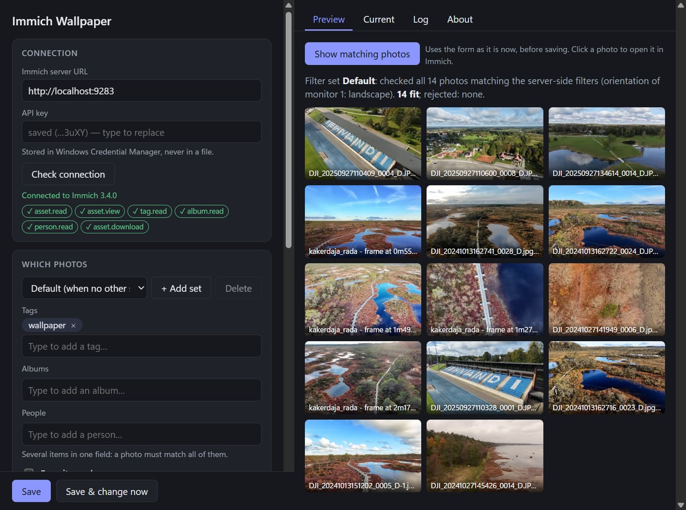
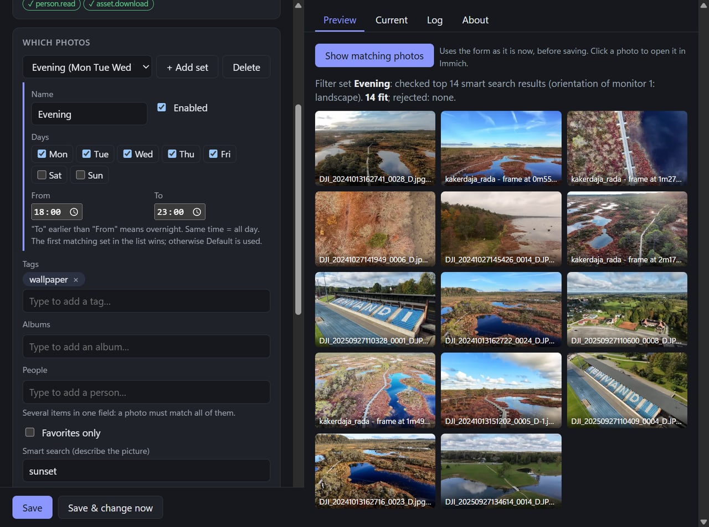

# Immich Wallpaper

Tray app for Windows that picks photos from Immich by filters and sets them as the desktop wallpaper.
Electron + TypeScript.



Filter sets switch the filters by day and time, for example a different selection on weekday evenings:



## Run

```bash
npm install
npm start            # dev run (autostart is not registered in dev mode)
npm run dist         # build release/win-unpacked/Immich Wallpaper.exe
npm run installer    # build release/ImmichWallpaper-Setup-<version>.exe (per-user, no admin)
```

## Releases

GitHub Actions (`.github/workflows/build.yml`) builds the installer on every push to `master`.
To publish a new version, bump `version` in `package.json` and push: the workflow creates the release
`v<version>` with `ImmichWallpaper-Setup-<version>.exe`. Pushes without a version bump only keep the installer
as a workflow artifact for 30 days.

## Features

- **Per monitor** (`perMonitor`, on by default): a separate photo on each monitor through `IDesktopWallpaper`;
  orientation "Auto" is matched per monitor, the same photo is never on two monitors. If Windows refuses,
  falls back to one picture for all monitors.
- **Filter sets** (`profiles`): extra sets of tags/albums/people/favorites/smart search active on given days and hours
  (overnight windows allowed). The first matching set wins, otherwise the default filters are used. The wallpaper
  changes as soon as a set starts or ends.
- **Lock screen** (`lockScreen`, off by default): the photo of monitor 1 also goes to the lock screen
  (WinRT `LockScreen.SetImageFileAsync`).
- **Full quality without server-side copies**: with "Full size" the app downloads the original of the picked photo
  and converts it locally (HEIC through heic-decode/WASM, everything else through sharp, EXIF rotation applied),
  scaled down to cover the monitor. JPEGs that already fit are saved as is. Falls back to Immich's fullsize,
  then preview. Immich's "Full-size image" generation can stay off.
- `IMMICH_WALLPAPER_CACHE` environment variable moves the photo cache to another folder.

`Immich Wallpaper.exe --next` changes the wallpaper in the running instance (handy for a hotkey shortcut).

## Tray menu

Next photo · Pause/Resume · Open in Immich (also double-click) · Never show this photo · Settings · Open log · Open cache folder.

## Where things live

| What | Where |
|---|---|
| Settings | `%APPDATA%\Immich Wallpaper\config.json` |
| API key | Windows Credential Manager, generic credential `immich-wallpaper:api-key` |
| History, "never show" list, current photo | `%APPDATA%\Immich Wallpaper\state.json` |
| Downloaded photos (offline pool) | `%APPDATA%\Immich Wallpaper\cache` |
| Log | `%APPDATA%\Immich Wallpaper\wallpaper.log` |

## API key permissions

`asset.read`, `asset.view` (search, thumbnails) · `tag.read`, `album.read`, `person.read` (filters by name) ·
`asset.download` (full-size images; without it the preview is used).

## Code

- `src/main.ts` – tray, schedule (survives sleep), settings IPC, thumbnail protocol for the preview grid
- `src/changer.ts` – one change: pick → get image → cache → set; retries and offline fallback
- `src/imageSource.ts` – original → local conversion/scaling → JPEG, with fullsize/preview fallbacks
- `src/picker.ts` – filters (orientation, size, aspect) and selection without repeats
- `src/immich.ts` – Immich REST client
- `src/win32.ts` – `SystemParametersInfoW` and Credential Manager through koffi
- `src/desktopWallpaper.ts` – `IDesktopWallpaper` COM calls through koffi (monitors, per-monitor wallpaper)
- `src/profiles.ts` – which filter set is active, next start/end time
- `src/lockscreen.ts` – lock screen image via PowerShell + WinRT
- `src/renderer/settings.ts`, `static/settings.html` – settings window
